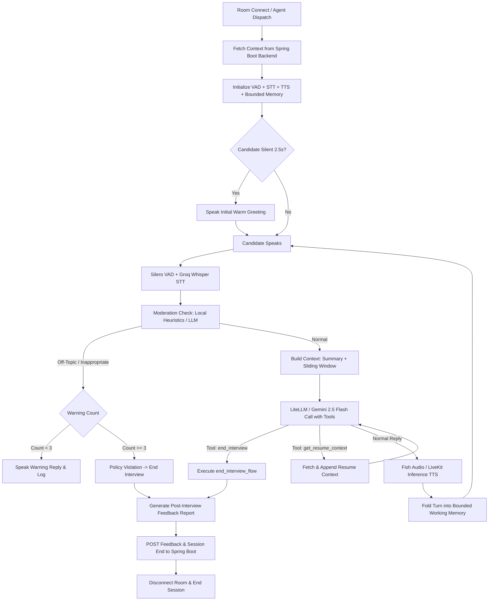
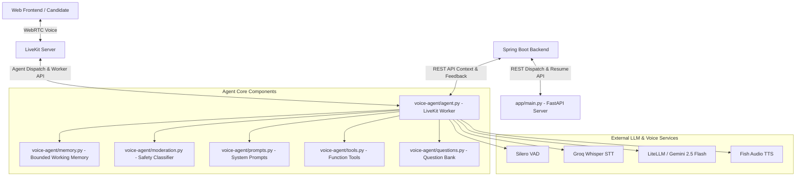

# 🤖 AI Voice Interview Agent & Resume Microservice

A standalone Python microservice and full-duplex conversational voice agent powering AI-driven technical job interviews.

---

## 🚀 Overview & Key Features

1. **LiveKit AI Voice Agent Worker (`voice-agent/agent.py`)** — Real-time voice interviewer with low-latency VAD, STT, LLM reasoning, Function Tool calling, and TTS.
2. **FastAPI Microservice (`app/`)** — Resume normalization (PDF text reconstruction), pre-flight job relevance screening, and explicit agent dispatching via LiveKit API.
3. **Bounded Working Memory (`voice-agent/memory.py`)** — Maintains a sliding window of recent turn pairs and folds older turns into a rolling summary to manage context size efficiently.
4. **Safety & Moderation (`voice-agent/moderation.py`)** — Fast local heuristics and LLM fallback to detect off-topic or inappropriate responses, with soft warning escalation and policy termination.
5. **Automated Evaluation Reporting** — Generates objective post-interview candidate feedback reports and posts them to the Spring Boot backend (`POST /api/ai-interview/{sessionId}/feedback`).

---

## 🔄 Agent Execution Flow

The voice agent executes a full-duplex conversational loop for every interview session:



---

## 🏗️ System Architecture & Code Structure



### 📁 Directory Layout

```
InterviewAgent/
├── voice-agent/                    # LiveKit real-time voice interview agent
│   ├── agent.py                    # Worker entrypoint & session lifecycle
│   ├── memory.py                   # Bounded working memory & rolling summarization
│   ├── moderation.py               # Local heuristic & LLM content moderation
│   ├── prompts.py                  # System prompts & feedback generation templates
│   ├── questions.py                # Static coding problem bank & prompts
│   ├── tools.py                    # LiveKit function tool definitions (@llm.function_tool)
│   ├── tests/                      # Voice agent & API test suite
│   │   ├── test_coding_tools.py    # Coding tool tests
│   │   ├── test_interruption.py    # Interruption & speech handle tests
│   │   ├── test_main.py            # FastAPI microservice endpoint tests
│   │   ├── test_memory.py          # Memory sliding window & fold tests
│   │   ├── test_ollama.py          # Local model integration tests
│   │   └── test_time_limits.py     # Time limit watchdog tests
│   └── conversations/              # Runtime local conversation JSON logs (gitignored)
├── app/                            # FastAPI microservice (resume processing & dispatch)
│   ├── controllers/                # FastAPI Router Endpoints
│   │   ├── health_controller.py    # Health check endpoint
│   │   ├── resume_controller.py    # Resume normalization & relevance endpoints
│   │   └── dispatch_controller.py  # LiveKit agent dispatch endpoint
│   ├── schemas/                    # Pydantic request & response schemas
│   │   └── resume_schema.py
│   ├── services/                   # Resume normalization & relevance service
│   │   └── resume_service.py
│   ├── config.py                   # App configuration & environment bindings
│   └── main.py                     # FastAPI microservice entrypoint
├── conftest.py                     # Pytest path configuration
├── pyrightconfig.json              # Pyright / IDE configuration
├── requirements.txt                # Python dependencies
├── start.sh                        # Dual-service container startup script
├── Dockerfile                      # Docker build definition
├── Procfile                        # Process manager file
├── render.yaml                     # Render deployment specification
└── README.md
```

---

## ⚙️ Setup & Running

### 1. Create & Activate Virtual Environment
```bash
python3 -m venv venv
source venv/bin/activate
```

### 2. Install Dependencies
```bash
pip install -r requirements.txt
```

### 3. Environment Configuration
Copy `.env.example` to `.env` and populate your credentials:
```env
GEMINI_API_KEY=your_gemini_api_key
OPENAI_API_KEY=your_openai_api_key
MODEL_NAME=gemini/gemini-2.5-flash
PORT=8000
LIVEKIT_URL=ws://127.0.0.1:7880
LIVEKIT_API_KEY=devkey
LIVEKIT_API_SECRET=secret
GROQ_API_KEY=your_groq_api_key
SPRING_BASE_URL=http://localhost:8080
INTERNAL_API_KEY=internal-secret-key
```

---

### 4. Run Services

#### FastAPI Microservice (Port 8000)
```bash
uvicorn app.main:app --reload --port 8000
```

#### LiveKit Voice Agent Worker
```bash
python voice-agent/agent.py dev
```

---

## 🧪 Running Unit Tests

```bash
pytest
```

---

## 🔗 API Endpoints Summary

- **GET `/health`**: Healthcheck (`{"status": "ok"}`)
- **POST `/resume/normalize`**: Reconstruct scrambled PDF text into structured Markdown
- **POST `/resume/check-relevance`**: Check candidate resume fit against target job title
- **POST `/dispatch-agent`**: Dispatch agent worker to a LiveKit room
- **POST `/analytics/evaluations`**: Store interview evaluation and update candidate topic mastery
- **GET `/analytics/evaluations/{sessionId}`**: Retrieve detailed evaluation record for a session
- **GET `/analytics/users/{userId}`**: Retrieve candidate analytics (top strengths, top weaknesses, mastery levels, averages)
- **GET `/analytics/users/{userId}/weak-topics`**: Get candidate's top weak topics to adapt future interview sessions
- **Interactive Swagger Docs**: [http://127.0.0.1:8000/docs](http://127.0.0.1:8000/docs)
